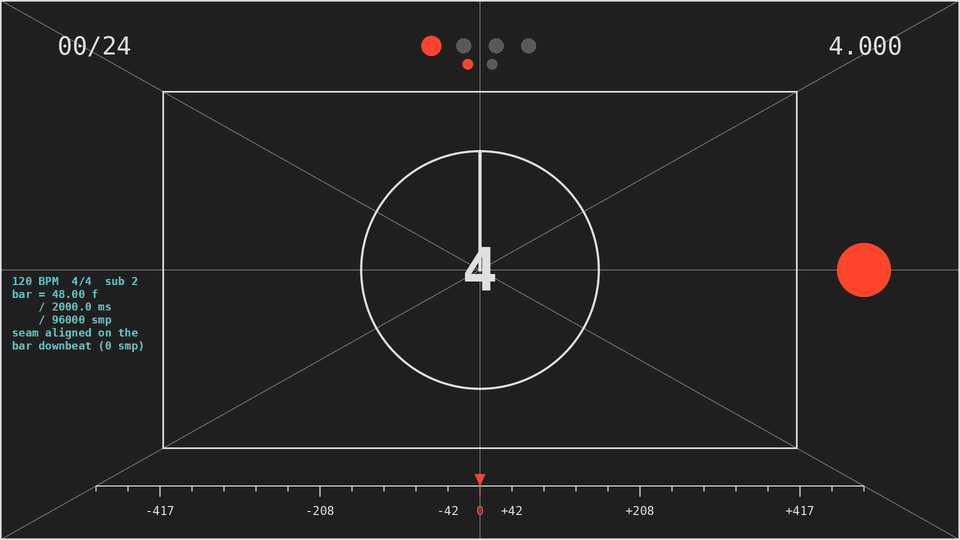
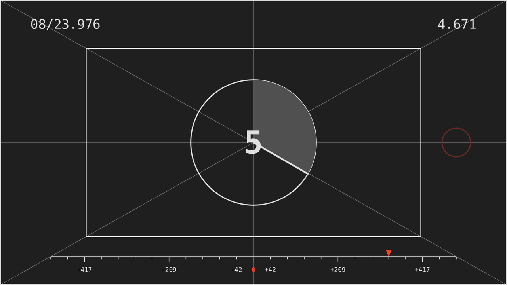
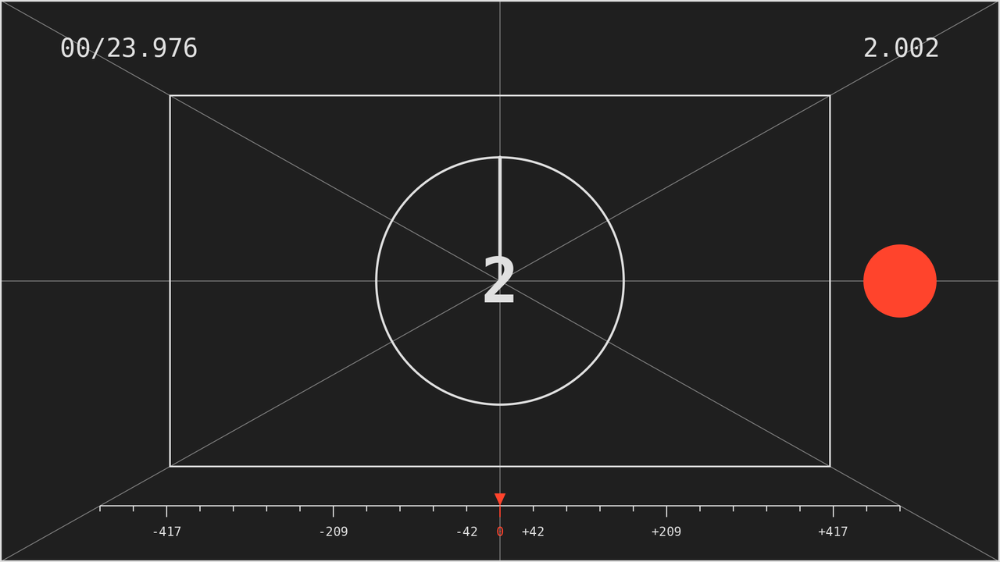
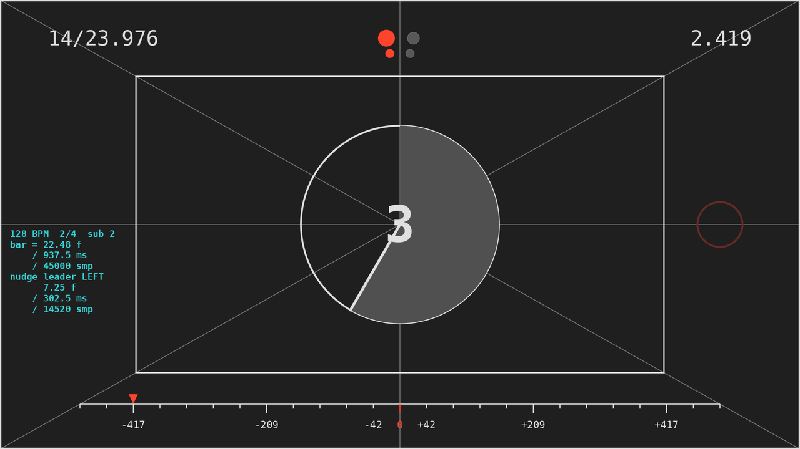
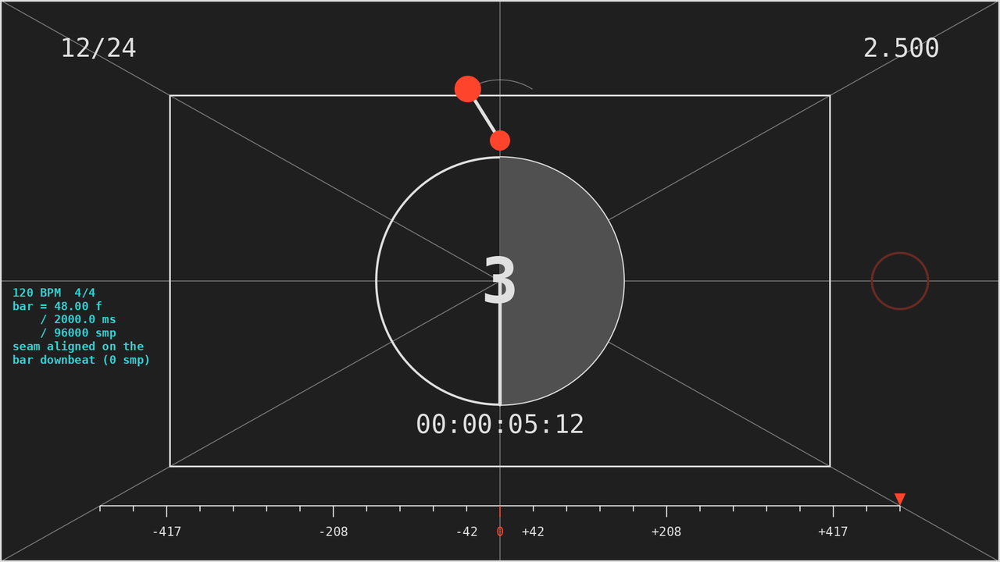

# smpte-leader-gen — AV-Sync Countdown Leader Generator

A command-line tool that renders an **audio/video synchronization test pattern**
inspired by the **SMPTE Universal Countdown Leader** ("the countdown clock"). Use
it to verify A/V sync, frame timing, and audio alignment across a playback or
editing pipeline.



*Four seconds (counting 4 → 1, including the 2-pop on the "2") of the
[metronome example](#with-a-metronome---bpm-enables-it) below. This GIF is
silent and browser GIF timing is approximate, so treat it as a preview only, not
as a sync reference. More stills are in
[What the output looks like](#what-the-output-looks-like).*

It is **not** a strict reproduction of the SMPTE 301 leader. It is an *AV-sync
test generator* that borrows the leader's visual language (rotating clock + sweep
wand, big descending numbers, a single-frame reference beep) and adds:

- a running **visual countdown timer** (precise ms, **top-right**),
- a zero-padded **per-second frame counter** in the **top-left**, whose denominator
  is the **actual fps** so near-identical rates stay distinct (e.g. `07/23.976`
  vs `07/24`),
- a **flashing circle** that flashes on the exact frame an audio cue fires,
- a **bottom "audio ruler"**: a per-frame tick scale **centred on zero** (the beep
  position in the middle) with major ticks labelled in **milliseconds** of A/V
  offset (and the two ticks flanking zero always labelled, so the per-frame
  increment is obvious), plus a moving playhead marker that **crosses the centre on
  every beep** — a calibrated reference for discovering and quantifying A/V-sync
  offset,
- **registration geometry**: a **full-frame border** marking the exact video extent,
  a smaller centred rectangle sharing the video's aspect ratio, plus semi-transparent
  corner-to-corner diagonals and a centre crosshair,
- a **single-frame 1 kHz sync beep** every leader-second, preserving the classic
  **"2-pop"** accent,
- an **optional metronome** (with subdivisions and an accented downbeat), shown by a
  top-center animation that ticks in lock-step with the audio clicks — by default a
  **row of beat dots** that light red one beat at a time (the downbeat larger), or
  optionally a **swinging pendulum** (`--metronome-style pendulum`),
- optional **`--end-align`**: extend the tail so the file ends exactly on the next
  metronome beat/bar/subdivision, so butt-joined music continues the click grid.

Frame and sample timing are accurate enough for fractional rates such as
**23.976 fps (24000/1001)**: video is encoded at the exact rational rate and audio
is pinned sample-for-frame with cumulative rounding, so there is **zero accumulated
A/V drift** over the whole file.

Frames are rendered in-process with **pycairo** (vector clock/wand) plus **Pillow**
(text), audio is synthesized in-process with **NumPy**, and the two are **muxed in a
single FFmpeg invocation** (raw RGB24 frames piped to FFmpeg stdin + a temp WAV).

---

## What the output looks like

These are single frames from real renders (1920×1080, encoded with the
lossless `x264lossless` profile, then scaled down for this page). The flags
under each image are the ones that change the picture; the profile does not.

| | |
|---|---|
|  |  |
| **Mid-countdown.** Default settings (`smpte-leader-gen -o leader.mov`), frame 80. Counter top left, countdown timer top right, audio ruler along the bottom, registration geometry everywhere else. | **The 2-pop.** Same render, frame 144: the first frame of the "2". The flash disc fires on the exact frame the beep starts, and the ruler playhead crosses zero. |
|  |  |
| **Metronome, dots style.** `--bpm 128 --time-sig 2/4 --subdivision 2` at the default 23.976 fps, frame 134. The beat and sub-pulse rows light up on each click. The turquoise readout shows how far to nudge the leader so your music's downbeat lands on the bar grid. | **Metronome, pendulum style.** `--fps 24 --bpm 120 --metronome-style pendulum --show-timecode-burnin`, frame 132. The pendulum reaches an extreme on every beat. The timecode burn-in sits below the clock. |

---

## Requirements

- **Python 3.11+** (developed and tested on 3.12).
- **FFmpeg ≥ 6.0** on `PATH` (`ffmpeg` and `ffprobe`). The tool fails fast if the
  detected FFmpeg major version is below 6. (Tested with FFmpeg 6.1.1.)
- System cairo libraries for `pycairo` (`libcairo2`, `pkg-config`, and a build
  toolchain).

The recommended environment is **Linux (Ubuntu 24.04 LTS)** for consistent FFmpeg
codec behavior (`prores_ks`, `ffv1`, `libx264`) and reproducible output. The code
is cross-platform, but golden-frame/byte-for-byte reproducibility depends on the
cairo/Pillow/FFmpeg versions.

---

## Install

### 1. System dependencies (Debian/Ubuntu)

```bash
sudo apt-get update
sudo apt-get install -y libcairo2-dev pkg-config ffmpeg build-essential
```

`libcairo2-dev` + `pkg-config` are needed to build/install `pycairo`. Ensure
`ffmpeg -version` reports **6.0 or newer**:

```bash
ffmpeg -version | head -1
```

### 2. Python virtual environment + editable install

```bash
python3 -m venv .venv
source .venv/bin/activate
pip install --upgrade pip
pip install -e .
```

This installs the runtime dependencies (`numpy`, `pycairo`, `pillow`,
`click>=8.1`, `pydantic>=2`, `soundfile`, `pyyaml`) and exposes the console
command:

```bash
smpte-leader-gen --help
```

For development (adds `pytest`):

```bash
pip install -e ".[dev]"
```

> The bundled deterministic fonts (`DejaVuSansMono.ttf`,
> `DejaVuSansMono-Bold.ttf`) ship inside the package under
> `smpte_leader_gen/fonts/`, so output text is reproducible across machines.

---

## Quickstart

All examples assume the venv is active (or prefix the command with
`.venv/bin/smpte-leader-gen`). `--output / -o` is **required**. The **container**
is resolved by precedence **`--container` > output file extension > profile
default**, and must be allowed by the chosen profile (an incompatible pairing,
e.g. ProRes into `.mp4`, is rejected up front with a clear error). The resolved
container governs the actual muxer, so `--container mov -o leader.mkv` writes a
QuickTime/MOV stream regardless of the `.mkv` extension.

### Default render (ProRes 422 HQ, 1080p, 23.976 fps, 8-second leader)

```bash
smpte-leader-gen -o leader.mov
```

Defaults: `--profile prores422hq`, `--resolution 1080p`, `--fps 24000/1001`,
`--lead-seconds 8`, `--tail-seconds 2`, 48 kHz / 24-bit stereo PCM, 1 kHz sync
beep with the 2-pop on the "2".

### Explicit 23.976 ProRes 422 HQ

```bash
smpte-leader-gen \
  --fps 23.976 \
  --resolution 1080p \
  --profile prores422hq \
  -o leader_23976.mov
```

`23.976` is mapped to the exact broadcast rational `24000/1001` (likewise `29.97`
→ `30000/1001`, `59.94` → `60000/1001`). You may also pass a bare integer (`30`)
or a rational (`24000/1001`).

### H.264 MP4 (maximum compatibility)

```bash
smpte-leader-gen \
  --fps 25 \
  --profile h264 \
  --container mp4 \
  -o leader.mp4
```

> Note: H.264 is inter-frame and slightly softens single-frame markers (flash,
> 2-pop). For frame-exact editorial checks prefer an intra-frame profile
> (`prores422hq`, `ffv1`, or `x264lossless`).

### With a metronome (`--bpm` enables it)

```bash
smpte-leader-gen \
  --fps 24 \
  --bpm 120 \
  --time-sig 4/4 \
  --subdivision 2 \
  -o leader_metronome.mov
```

The metronome is off by default and enabled simply by passing `--bpm`. The
downbeat (first beat of each bar) is accented; `--subdivision 2` adds eighth-note
clicks. Click timbres (accent 2000 Hz / beat 1500 Hz / subdivision 1200 Hz) are
deliberately **distinct from the 1 kHz sync beep**.

Whenever `--bpm` is set, a top-center animation appears, in one of two styles
(`--metronome-style`):

- **`dots`** (default): a horizontal row of beat lights, one per beat of the bar.
  Each beat lights its dot red in turn — the lit light marches across the row — and
  the bar's downbeat is the larger accent dot, so the downbeat reads by size as
  well as colour. With `--subdivision > 1` a second, smaller row appears below it
  and marches the subdivision pulse within the beat, so every audible click is
  represented (beats on top, sub-pulses below). The beat row sits at the top
  readout level — between the corner frame-counter and timer, reading as a header
  — and each dot flashes briefly rather than smearing.
- **`pendulum`**: an inverted "Maelzel" pendulum that swings one beat per
  half-swing, reaching an extreme exactly on each beat; the bob lights up on every
  beat (brighter, with a ring, on the downbeat) and the pivot pulses on every
  click, so subdivisions read as a finer tick.

Either way the motion is derived from the same sample grid as the audio, so the
visual stays locked to the clicks.

### SMPTE count style (fixed 8 → 2)

```bash
smpte-leader-gen \
  --count-style smpte \
  --lead-seconds 8 \
  -o leader_smpte.mov
```

`--count-style smpte` shows the classic fixed `8,7,6,5,4,3,2` sequence (requires
`--lead-seconds >= 8`). The `"2"` second carries the 2-pop. The default
`--count-style full` instead counts `L → 1`.

---

## CLI flag reference

Grouped to mirror SPEC §5. Run `smpte-leader-gen --help` for the authoritative,
in-tool listing. `--config FILE` (YAML/JSON, keys mirror the flag names with
hyphens or underscores) is read first; **explicit CLI flags override file values**.

### Core

| Flag | Type | Default | Notes |
|---|---|---|---|
| `--lead-seconds` | int | `8` | Number of leader-seconds counted down (≥ 1). |
| `--tail-seconds` | float | `2` | Black tail after t=0, in leader-seconds (≥ 0; may be 0). |
| `--preroll-seconds` | float | `0` | Optional black/slate before the countdown (≥ 0). |
| `--fps` | str | `24000/1001` | Preset (`23.976`,`24`,`25`,`29.97`,`30`,`50`,`59.94`,`60`), integer, or `num/den`. Broadcast decimals map to exact rationals. |
| `--resolution` | str | `1080p` | Preset (`720p`,`1080p`,`2kdci`,`uhd4k`) or `WxH`. |
| `--output` / `-o` | path | **required** | Output file path. |

### Encoding

| Flag | Type | Default | Notes |
|---|---|---|---|
| `--profile` | choice | `prores422hq` | One of the profiles in the table below. |
| `--container` | choice | from profile | `mov` / `mkv` / `mp4`. Must be allowed by the profile. |
| `--start-timecode` | str | `00:00:00:00` | Embedded SMPTE timecode start. |
| `--no-drop-frame` | flag | off | Disable drop-frame (auto-on for 29.97 / 59.94). |

### Audio

| Flag | Type | Default | Notes |
|---|---|---|---|
| `--sample-rate` | int | `48000` | 8000–192000. |
| `--bit-depth` | choice | `24` | `16` or `24` (PCM). |
| `--beep-freq` | float | `1000` | Sync beep frequency (Hz, > 0). |
| `--beep-frames` | int | `1` | Beep length in frames (≥ 1). |
| `--beep-level-dbfs` | float | `-12` | Peak level of the beep. |
| `--no-persecond-beep` | flag | off | Only the 2-pop fires (classic). |
| `--no-twopop` | flag | off | Disable the 2-pop accent. |
| `--no-beep` | flag | off | Mute **all** countdown beeps (per-second + 2-pop) so the metronome is heard alone. The visual flash is unaffected. |

### Metronome (audio clicks + top-center animation; enabled by `--bpm`)

| Flag | Type | Default | Notes |
|---|---|---|---|
| `--bpm` | float | none | Presence enables the metronome (10–999). |
| `--time-sig` | str | `4/4` | `beats/value`; first beat of each bar is accented. |
| `--subdivision` | int | `1` | Clicks per beat (1=quarter, 2=eighth, 4=sixteenth…). |
| `--metronome-start` | str | `0` | `0` (file start), `t0` (at FFOP), or seconds offset. |
| `--metronome-level-dbfs` | float | `-14` | |
| `--metronome-accent-freq` | float | `2000` | Downbeat click frequency. |
| `--metronome-click-freq` | float | `1500` | Beat click frequency. |
| `--metronome-sub-freq` | float | `1200` | Subdivision click frequency. |
| `--metronome-style` | choice | `dots` | Visual style: `dots` (row of beat lights) or `pendulum` (swinging arm). |
| `--end-align` | choice | none | `beat`/`bar`/`subdivision`: extend the black tail so the output ends exactly on the next metronome grid point (requires `--bpm`). |
| `--end-cue` | flag | off | With `--end-align`, sound the final boundary beat as an audio cue and end just after it (instead of ending silently on the boundary). |

#### Ending on a downbeat (`--end-align`)

When you butt-join your music to the end of the leader, `--end-align` makes the
file end land exactly where the metronome's next **beat** (or **bar** /
**subdivision**) would fall, so the song's downbeat continues the click grid
seamlessly. The black tail is only ever **extended** (never shortened) to reach
that boundary, and the metronome keeps ticking through the tail up to it.
Alignment is computed in the frame domain — the granularity you cut on — so it is
frame-accurate (sample-exact when the unit spans a whole number of frames, e.g.
integer fps with a compatible tempo; within half a frame otherwise).

```bash
# Ends on the next bar boundary so the music's downbeat continues the groove.
smpte-leader-gen --fps 24 --bpm 120 --time-sig 4/4 \
  --tail-seconds 1.0 --end-align bar -o leader_endbar.mov
```

Whenever the metronome is active (`--bpm`), a small **bold turquoise readout
appears on the left** (hugging the left frame border, its first line just below
the horizontal centre line) with the metrics for aligning the seam to the **bar
downbeat**. The header is just the metronome parameters (`BPM`, time signature,
and `sub N` when subdividing) — the fps is omitted because it already shows in
the top-left frame counter — and the bar period and nudge are reflowed onto short
lines so the block stays clear of the inner registration rectangle:

```
128 BPM  2/4  sub 2
bar = 22.48 f
    / 937.5 ms
    / 45000 smp
nudge leader LEFT
      0.34 f
    / 14.3 ms
    / 686 smp
```

The nudge is the signed amount to apply to the **leader** so that, with your
music butted to the leader's end, the music's downbeat lands on the metronome's
bar grid (the leader's bar grid, extended, continues into the music). `+` = move
the leader right, `−` = left; the direction and size vary per render. With
**`--end-align bar`** this is sub-frame (just the leftover the frame grid cannot
represent — so the seam is already frame-accurate and you only need it if you want
sample-perfect). Without bar alignment it can be up to half a bar, telling you how
far the seam currently sits from a downbeat.

By default (with `--end-align`) the boundary beat itself is **silent** — the file
ends exactly on it,
leaving that downbeat for your music to take over. Add **`--end-cue`** to instead
**sound** that boundary beat (the first beat of the next period) as an audio
marker and end just after it — useful as a count-in whose final click you can
align your music to:

```bash
# ...metronome ticks through the tail, the final downbeat clicks, then it ends.
smpte-leader-gen --fps 24 --bpm 120 --time-sig 4/4 \
  --tail-seconds 1.0 --end-align bar --end-cue -o leader_countin.mov
```

### Visual toggles

| Flag | Type | Default | Notes |
|---|---|---|---|
| `--count-style` | choice | `full` | `full` (L→1) or `smpte` (fixed 8→2; requires `L ≥ 8`). |
| `--bg-color` | hex | `#202020` | Background color. |
| `--fg-color` | hex | `#E0E0E0` | Foreground (clock/lines/most text; the left-side metronome readout is a fixed turquoise). |
| `--accent-color` | hex | `#FF3030` | Flash disc / accent. |
| `--show-timecode-burnin` | flag | off | On-screen TC overlay (separate from embedded TC). |
| `--no-clock` | flag | off | Hide the clock + wand. |
| `--no-counter` | flag | off | Hide the `x/N` frame counter. |
| `--no-timer` | flag | off | Hide the digital countdown timer. |
| `--no-flash` | flag | off | Hide the flashing circle. |
| `--frames-per-block` | int | none | Override `F` (frames per leader-second). |
| `--timer-format` | choice | `auto` | `auto` / `seconds` / `frames` / `tc`. |
| `--seed` | int | `0` | Reserved for future randomization; output is deterministic. |

### Runtime

| Flag | Type | Default | Notes |
|---|---|---|---|
| `--jobs` | int | `1` | Parallel render workers (≥ 1); frame order stays strict. |
| `--ffmpeg-path` | path | none | Explicit `ffmpeg` location (`ffprobe` derived alongside). |
| `--config` | path | none | YAML/JSON config file; explicit flags override it. |
| `--verbose` / `-v` | flag | off | Print FFmpeg version and resolved config. |

---

## Encoding profiles (`--profile`)

| Profile | Video | Pix fmt | Container (allowed) | Audio | Even dims | Notes |
|---|---|---|---|---|---|---|
| `prores422hq` *(default)* | `prores_ks -profile:v 3` | `yuv422p10le` | `mov` (mov, mkv) | `pcm_s24le`/`pcm_s16le` | yes | Editorial standard, intra-frame. |
| `prores4444` | `prores_ks -profile:v 4` | `yuva444p10le` | `mov` (mov, mkv) | `pcm_s24le`/`pcm_s16le` | no | If alpha / higher quality needed. |
| `ffv1` | `ffv1 -level 3` | `yuv422p10le` | `mkv` (mkv) | `pcm_s24le`/`pcm_s16le` | yes | Mathematically lossless, archival. |
| `x264lossless` | `libx264 -qp 0` | `yuv444p` | `mkv` (mkv, mov) | `pcm_s24le`/`pcm_s16le` | no | Lossless, often smaller than FFV1. |
| `h264` | `libx264 -crf 18 -preset slow` | `yuv420p` | `mp4` (mp4, mkv) | `aac 320k` | yes | Max compatibility; inter-frame softens single-frame markers. |

Notes:

- The **PCM bit depth** of PCM profiles follows `--bit-depth` (24 → `pcm_s24le`,
  16 → `pcm_s16le`). The `h264` profile uses `aac` at 320 kbps.
- "Even dims" means the pixel format is chroma-subsampled and **width and height
  must both be even**; the config validator enforces this and fails fast.
- Incompatible profile/container combinations (e.g. ProRes in `mp4`) are
  rejected with a clear error.
- All HD outputs carry BT.709 color metadata
  (`-color_primaries bt709 -color_trc bt709 -colorspace bt709`).
- **Matroska + 59.94 fps reporting:** the tool always passes the exact rational
  rate (`-r 60000/1001`) to FFmpeg, and MOV/MP4 store it exactly (timebase
  `1/60000`, so `ffprobe` reports `r_frame_rate = 60000/1001`). Matroska (`.mkv`,
  used by `ffv1`/`x264lossless`) stores per-frame duration as an integer number
  of nanoseconds, and `1001/60000 s` is not an exact nanosecond count, so
  `ffprobe` re-derives a near-equal rate (`19001/317 ≈ 59.94006`, error < 4e-6)
  for the 59.94 family in MKV. This is a container limitation, not a timing
  error — frame and audio durations remain correct. For bit-exact `r_frame_rate`
  at 59.94, prefer a MOV/MP4 profile (the default `prores422hq` is exact).

---

## The frame-centric leader-second model (F frames) and the 2-pop

This tool is **frame-centric**, matching film-leader convention. Two timebases
work together:

- **`fps` (media timebase):** the exact rational frame rate the file is encoded at,
  `fps = num/den` (e.g. `24000/1001`). This governs real-time playback duration and
  is always exact — the exact rational is passed to FFmpeg's `-r`, never a decimal
  like `23.98`.
- **`F` (frames per leader-second block):** `F = round(fps)` (override with
  `--frames-per-block`). This integer drives every on-screen cue:
  - the `x/N` counter denominator (`N = F`, displayed as `j/(F-1)`),
  - the number of frames in one **leader-second**,
  - one full revolution of the sweep wand.

A **leader-second** is therefore a block of exactly **F frames** — not a wall-clock
second. For frame index `i` (0-indexed over the whole output):

- leader-second `s = (i − preroll) // F`
- per-second counter `j = (i − preroll) % F`, drawn as `j/(F-1)`
- wand fraction `p = ((i − preroll) % F) / F` (clockwise from 12 o'clock; resets
  cleanly each block boundary)
- countdown number (`full` style) `= L − s`, counting `L → 1`

**Why frames, not wall-clock seconds:** at fractional rates the number of *encoded*
frames in a true wall-clock second is non-integer (≈ 23.976 at 23.976 fps), which
would make the `x/N` counter and the wand revolution irregular (sometimes 23,
sometimes 24 frames). Fixing the leader-second at exactly `F` frames keeps every
on-screen cue clean and deterministic. The file is still encoded at the exact
rational `fps`, so **real-time duration is correct** — a "leader-second" at 23.976
fps simply lasts `F/fps = 24·1001/24000 ≈ 1.00100 s` of real time. This is the
correct trade-off for a frame-alignment tool and matches film-leader convention.

**Total frame layout:**

```
total_frames = preroll_frames  +  L·F (countdown)  +  tail_frames (black)
```

- **t=0 / First Frame Of Picture (FFOP):** the reference instant the leader counts
  down to — `ffop_frame = preroll_frames + L·F`, the frame immediately after the
  countdown reaches zero. All timing is measured backward from here.
- **Black tail:** literal black frames after t=0.

**The 2-pop.** The 2-pop is the canonical alignment marker: a single sync beep at
exactly **2 leader-seconds (2·F frames) before t=0**, coinciding with the big
number **"2"**:

```
twopop_frame = ffop_frame − 2·F   (== preroll + (L−2)·F)
```

It is one of the per-second beeps but flagged so the **flash accents it** (rendered
larger / in a second accent color). With `--no-persecond-beep` the 2-pop is the
*only* beep that fires; `--no-twopop` removes the accent. `--no-beep` silences the
whole beep track (per-second **and** 2-pop) so the metronome plays alone; the
visual flash still fires (it keys off the schedule, not the audio).

Because the 2-pop is bound to the **"2"** second, it requires `--lead-seconds >= 2`.
A shorter leader with the 2-pop enabled is rejected up front — use `--no-twopop`
(or a longer leader) for `--lead-seconds 1`.

**Drift-free audio.** Audio is one contiguous PCM buffer. Every frame's start
sample is pinned by cumulative rounding, not by accumulating a non-integer
samples-per-frame:

```
frame_start_sample(i) = round(i · sample_rate · den / num)
total_samples         = frame_start_sample(total_frames)
```

A cue scheduled "on frame `i`" starts at `frame_start_sample(i)`, and audio length
matches video duration to within one sample. **The flash and the beep onset are
always on the same frame** (the flash frames are derived directly from the beep
cue frames), which is the heart of the A/V alignment check.

---

## Manual editorial A/V-sync check (SPEC §11.6)

This is the human acceptance test. Use an intra-frame profile so single-frame
markers stay crisp.

1. **Render a 23.976 fps ProRes file** (default profile is fine):

   ```bash
   smpte-leader-gen --fps 23.976 --profile prores422hq -o sync_check.mov
   ```

2. **Import it into an NLE** (e.g. DaVinci Resolve — free — or Premiere Pro) and
   drop it on a 23.976 fps timeline.

3. **Confirm the flash frame == the beep onset frame.** Step through frame by
   frame. On every per-second beep, the on-screen **flash disc** must light up on
   **exactly the frame where the audio beep begins** — not one frame early or late.
   Inspect the audio waveform: the beep's onset sample should sit at the very start
   of the flash frame.

4. **Confirm the 2-pop sits on the "2" frame, 2 leader-seconds before t=0.** Find
   the frame showing the big number **"2"**: its first frame is the 2-pop. Verify
   that:
   - the 2-pop beep onset and its (accented) flash are on that frame, and
   - that frame is exactly **2·F frames** before the First Frame Of Picture (t=0)
     — i.e. `ffop_frame − 2·F`. At 23.976 fps, `F = 24`, so the 2-pop is 48 frames
     before t=0.

5. **Confirm t=0 / black tail.** After the countdown reaches the end of the "1"
   second, the next frame is t=0 (FFOP). With the default leader the picture then
   transitions to the black tail; t=0 is the reference zero everything counts down
   to.

If the flash and beep ever diverge, or the 2-pop is off the "2", the playback or
edit chain has introduced A/V offset.

---

## Running the tests

```bash
make verify        # runs the full pytest suite via the project venv
```

or directly:

```bash
.venv/bin/python -m pytest -q
```

The suite is split per CONTRACT §11: `test_timing.py`, `test_audio.py`,
`test_layout.py`, `test_render.py`, `test_config.py`, `test_profiles.py`,
`test_encode.py`, and `test_integration.py`, plus `test_cli.py`,
`test_pipeline.py`, and `test_review_fixes.py`.

The **unit tests** (timing, audio synthesis, layout, render, config, profiles,
encode command construction) are pure and run without FFmpeg. The
**integration tests** render tiny end-to-end files and assert on `ffprobe`
output (`r_frame_rate`, `nb_frames`, sample rate, channel count, embedded
timecode incl. drop-frame). They **skip gracefully when FFmpeg is not on PATH**,
so `make verify` is green on machines without FFmpeg.

> Golden-frame render hashes depend on the installed cairo / Pillow versions; if
> those differ from the development environment the golden test may need its
> stored hash refreshed.

---

## Project layout

```
smpte_leader_gen/
  __init__.py     # version
  cli.py          # click entrypoint, arg parsing -> Config
  config.py       # pydantic Config, fps/resolution/color parsing, validation
  timing.py       # rational fps, frame<->sample math, cue schedule (PURE)
  layout.py       # element positions/sizes from W,H (PURE)
  render.py       # per-frame drawing (cairo + Pillow) -> RGB24 bytes
  audio.py        # beep / 2-pop / metronome synthesis -> stereo PCM -> WAV (PURE)
  encode.py       # FFmpeg command construction, discovery, timecode
  pipeline.py     # orchestrates schedule -> stream frames -> mux
  profiles.py     # the encoding profile table (PURE)
  fonts/          # bundled deterministic fonts
tests/            # pytest suite (see "Running the tests")
pyproject.toml
Makefile
```

---

## License

MIT. See [`LICENSE`](LICENSE).

The bundled DejaVu Sans Mono fonts (`smpte_leader_gen/fonts/`) are distributed
under their own license (Bitstream Vera / Arev, DejaVu changes in the public
domain). See [`smpte_leader_gen/fonts/LICENSE`](smpte_leader_gen/fonts/LICENSE).
